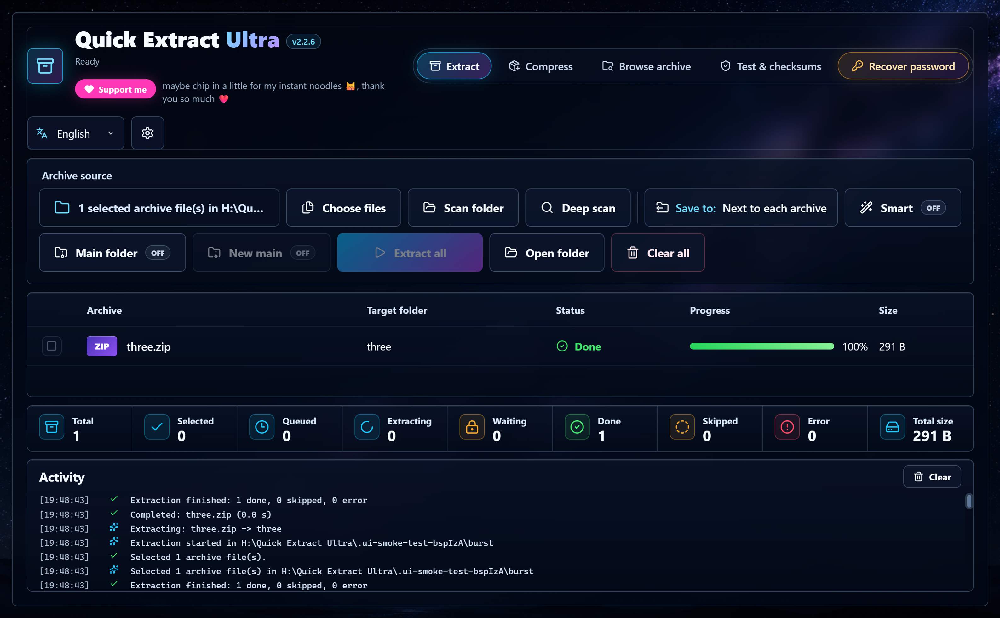

<div align="center">


# Quick Extract Ultra

**A free, friendly archive manager for Windows. Extract, compress, look inside and verify ZIP, 7Z, RAR and 30+ other formats.**

**English** · [日本語](docs/README.ja.md) · [Tiếng Việt](docs/README.vi.md) · 简体中文 · 繁體中文

[](https://github.com/nyankuro/quick-extract-ultra/releases/latest)
[](LICENSE)

[](https://github.com/nyankuro/quick-extract-ultra/actions)



</div>

---

## Why Quick Extract Ultra?

Most archive tools were designed decades ago. Quick Extract Ultra does the same jobs as WinRAR or 7-Zip, but in a modern window that tells you exactly what is happening:

- 🗂️ **Extract dozens of archives in one click**, each into its own folder, with live progress.
- 🔐 **Passwords never block the queue.** Protected archives wait politely while the rest keep going.
- 🧠 **Smart extraction** avoids the annoying "folder inside a folder with the same name".
- 🛡️ **Safe by design.** Nothing is ever overwritten, half-finished output never appears, and downloaded files keep Windows' safety warnings.
- 🌏 **Five languages** — English, 日本語, Tiếng Việt, 简体中文, 繁體中文 — switchable at any time.
- 💻 **100% offline.** Your files never leave your computer.

## Features

| | What it does |
|---|---|
| **Extract** | Choose files, scan a folder, or deep-scan subfolders. Batch extract with per-file progress, a "Main Zip" collection folder, and smart mode. |
| **Compress** | Create **7Z, ZIP, TAR, TAR.GZ, TAR.XZ, TAR.BZ2** archives. Six compression levels, AES-256 passwords, hidden file names (7Z) and split volumes (100 MB, 700 MB, 1 GB, 4 GB). |
| **Browse archive** | Look inside without extracting. Folders, search, sizes, dates and encrypted-file markers. Extract only what you select. |
| **Test** | Check every file in an archive against its stored checksum, without extracting. |
| **Checksums** | CRC32, MD5, SHA-1, SHA-256 and SHA-512, with copy buttons and a "paste to compare" box. |
| **Explorer menu** | Right-click → *Extract here (smart)*, *Extract to folder*, *Open*, *Test*, *Add to archive…*, *Add to ZIP*, *Add to 7Z*, *Calculate checksums*. Turn it on in Settings. |
| **Recover ZIP password** | For your own ZIP files: recover a forgotten password with the open-source tools bkcrack, hashcat (GPU) and John the Ripper (CPU), run as separate programs. See below. |
| **Drag & drop** | Drop files on any tab: archives to extract, files to compress, an archive to browse, files to hash. |
| **Multi-part archives** | `.part1.rar`, `.7z.001` and friends are opened through the first part; later parts are hidden from scans. |

**Opens:** ZIP, ZIPX, 7Z, RAR (incl. RAR5), TAR, GZ, TGZ, BZ2, XZ, TXZ, ZST, LZ, LZMA, Z, CAB, ISO, WIM, ARJ, LZH/LHA, CPIO, RPM, DEB, DMG, VHD, VHDX, XAR and split `.001` files.

<details>
<summary><b>More screenshots</b></summary>

| Compress | Browse archive |
|---|---|
|  |  |
| **Test & checksums** | **Password queue** |
|  |  |

</details>

## Recover a forgotten ZIP password

The **Recover ZIP password** tab helps you back into a ZIP **you own or are allowed to open** (the app shows a reminder about this). It contains no cracking code of its own — it runs three well-known open-source tools as separate programs, so their licenses (including John's GPL) stay separate from this app:

- **bkcrack** — if the ZIP uses the old ZipCrypto format and you still have one original (unencrypted) file that is inside it, this recovers the password very fast.
- **hashcat** (GPU) and **John the Ripper** (CPU) — otherwise the app reads the ZIP's hash with John's `zip2john` and searches for the password: a wordlist first (a small common-password list is built in), then brute force over a character set and length you choose. On an AES ZIP it uses your GPU through hashcat; otherwise John on the CPU.

These tools are **not bundled** and are never re-hosted. In the app you add each one either with an **automatic download** (a confirmation box shows the tool's name, license, size and official source, and the download is checked against the source's published SHA-256) or **manually** from its official page. Downloads are saved under `%APPDATA%\quick-extract-ultra\tools\`. John is the base tool (its `zip2john` reads the hash); hashcat is an optional GPU accelerator; bkcrack is the standalone fast path.

The tab shows live progress, speed and estimated time, with Pause, Resume and Cancel. When the password is found it is shown clearly with a copy button and an **Extract now** button.

## Download & install

1. Go to the [**latest release**](https://github.com/nyankuro/quick-extract-ultra/releases/latest).
2. Download one of these:
   - **`QuickExtractUltra-Setup-x.y.z.exe`**: installer (recommended). Adds Start menu and Desktop shortcuts. No administrator rights needed.
   - **`QuickExtractUltra-Portable-x.y.z-win-x64.zip`**: portable version. Unzip it anywhere (even a USB stick) and run `Quick Extract Ultra.exe`.
3. Run it. If Windows SmartScreen says *"Windows protected your PC"*, click **More info → Run anyway**. This appears because the app is new and not code-signed yet; the full source code is right here for anyone to check.

To uninstall, use **Settings → Apps** in Windows. The Explorer menu is removed automatically.

## How to use

### Extract archives
1. Open the **Extract** tab.
2. Drop archives into the window, or click **Choose files**, **Scan folder** or **Deep scan** (includes subfolders).
3. Optional switches:
   - **Save to**: by default each archive is extracted next to itself. Click it to pick another folder (the × button switches back).
   - **Smart**: if an archive contains just one folder or file, it comes out directly, without an extra wrapper folder.
   - **Main folder**: all results go into one `Main Zip` folder. **New main** makes a fresh `Main Zip (1)` for this run.
4. Click **Extract all**. Each archive goes into a new folder named after it; if that name is taken, `(1)`, `(2)`… is added. Nothing is ever overwritten.
5. If an archive needs a password, a password box appears on its row. Type it and press **Continue**, or **Skip**. Other archives keep extracting meanwhile.

### Create an archive
1. Open **Compress** and drop files/folders, or use **Add files** / **Add folder**.
2. Choose a name, folder, format and compression level.
3. Optional: a password (7Z or ZIP), *hide file names* (7Z), or *split into parts*.
4. Click **Create archive**. When it finishes, **Show in folder** takes you to it.

> 💡 ZIP passwords must use English letters, numbers and symbols (a 7-Zip limitation). For passwords with accents or Japanese characters, choose 7Z.

### Look inside an archive
Open **Browse archive**, then **Open archive** (or drop one in). Double-click folders to move around, use the search box, tick items and press **Extract selected**, or **Test** to verify everything.

### Add the right-click menu
Click ⚙️ **Settings** → turn on **Explorer right-click menu**. It adds *Extract files… (choose folder)*, *Extract here (smart)*, *Extract to folder* and more. On Windows 11 the entries are under **Show more options** (or press Shift+F10). The menu is only added for your Windows account and is removed when you turn the setting off.

### Settings
| Setting | Default | Meaning |
|---|---|---|
| Language | English | English / 日本語 / Tiếng Việt |
| Explorer right-click menu | Off | Adds the context menu described above |
| Open the folder after extracting | Off | Opens Explorer when a job finishes |
| Keep download safety warnings | **On** | Extracted files keep the "downloaded from the internet" mark, so SmartScreen and Office Protected View still protect you |
| Move archives to the Recycle Bin after extracting | Off | Only after success; multi-part sets move together and can be restored |

## FAQ

**Can it create RAR files?**
No. RAR creation is proprietary to WinRAR. Quick Extract Ultra opens RAR (including RAR5) and creates 7Z, ZIP and TAR-based formats, which every modern tool can open.

**Is it safe? Does it upload anything?**
Everything runs locally with the well-known 7-Zip engine. The app has no telemetry and makes no network requests. Extraction happens in a temporary folder first; only a complete, checksum-verified result is moved into place.

**Why does Windows warn me when I first run it?**
New apps without a paid code-signing certificate show a SmartScreen warning. Choose **More info → Run anyway**. We'd love to sign releases in the future; see [Support the project](#support-the-project).

**Where are my settings stored?**
In `%APPDATA%\quick-extract-ultra\settings.json`. Archive lists and passwords are never saved.

## Build from source

You need [Node.js](https://nodejs.org/) 22 or newer and Windows 10/11.

```bash
git clone https://github.com/nyankuro/quick-extract-ultra.git
cd quick-extract-ultra
npm ci
npm run dev        # run with live reload
npm test           # archive integration tests (real 7-Zip)
npm run test:ui    # Electron UI smoke test
npm run dist       # build the installer and portable exe into dist/
```

Project layout: `electron/` (main process, 7-Zip, Explorer integration), `src/` (React interface), `locales/` (translations), `scripts/` (tests and tools).

## Contributing

Bug reports, ideas and translations are very welcome! Please open an [issue](https://github.com/nyankuro/quick-extract-ultra/issues). To add a language, copy `locales/en.json`, translate the values, and add it to `src/i18n.tsx` and `electron/settings.cjs`.

## Support the project

Quick Extract Ultra is free and always will be. If it saves you time, you can help keep it going:

- ⭐ **Star this repository**. It really helps others find it.
- 🐛 Report bugs and suggest features in [Issues](https://github.com/nyankuro/quick-extract-ultra/issues).
- ☕ **[Support me on Ko-fi](https://ko-fi.com/nyannyankuro)** — there's also a "Support me" button in the app, under the title.
  - GitHub Sponsors: *coming soon*
  - PayPal: *coming soon*

## License

[MIT](LICENSE) © 2026 nyankuro.
Powered by [7-Zip](https://www.7-zip.org/) by Igor Pavlov (GNU LGPL + unRAR restriction). See [THIRD_PARTY_NOTICES.md](THIRD_PARTY_NOTICES.md).
Inspired by the great open-source archivers [7-Zip](https://www.7-zip.org/), [NanaZip](https://github.com/M2Team/NanaZip) and [PeaZip](https://github.com/peazip/PeaZip).
