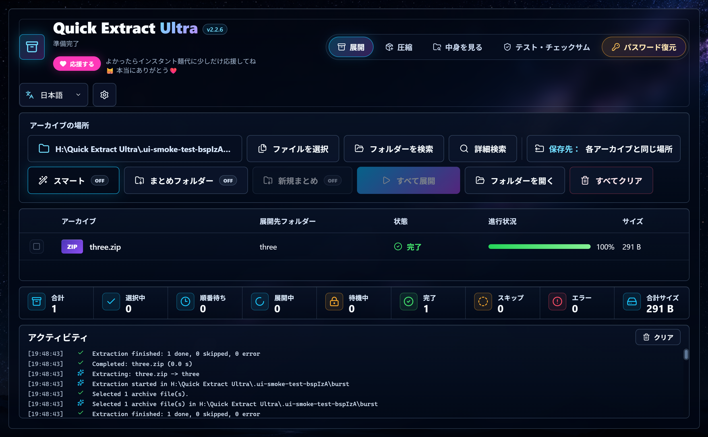
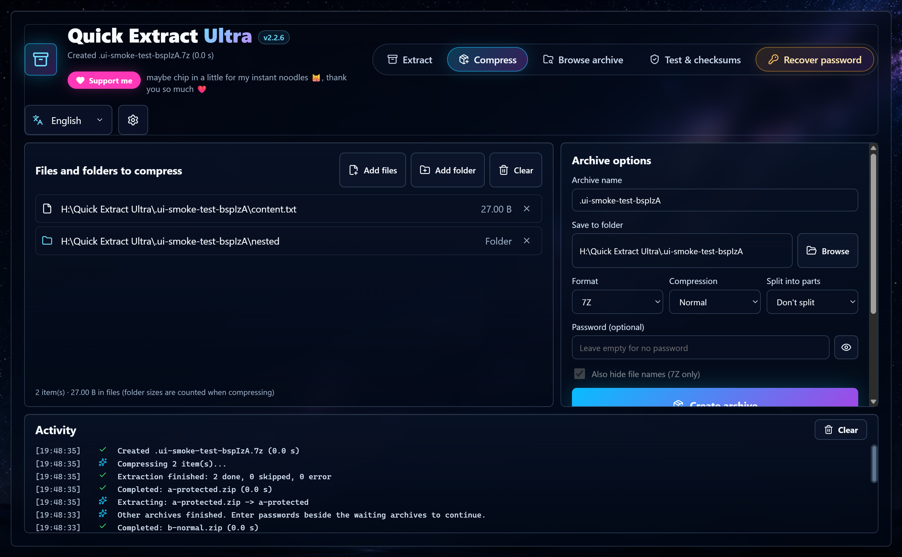
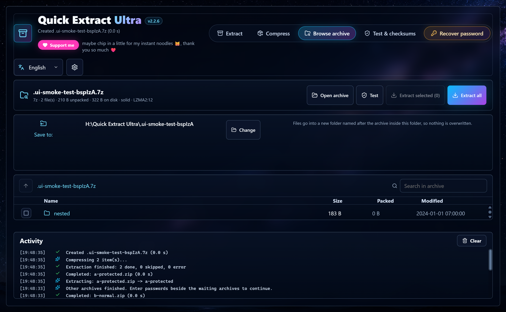
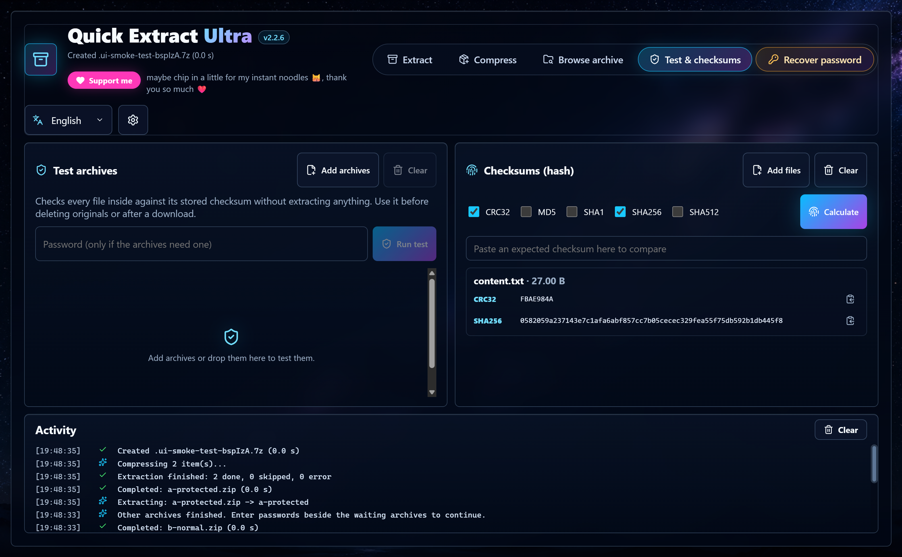
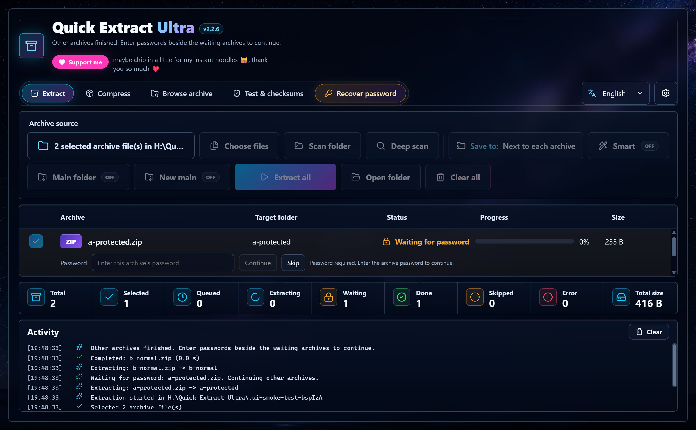

<div align="center">


# Quick Extract Ultra

**Windows 向けの無料でやさしいアーカイブ管理ツール。ZIP・7Z・RAR など 30 種類以上の形式を展開・圧縮・中身の確認・検証できます。**

[English](../README.md) · **日本語** · [Tiếng Việt](README.vi.md) · 简体中文 · 繁體中文

[](https://github.com/nyankuro/quick-extract-ultra/releases/latest)
[](../LICENSE)




</div>

---

## Quick Extract Ultra の特長

WinRAR や 7-Zip と同じ作業を、今何が起きているかがひと目でわかるモダンな画面で行えます。

- 🗂️ **たくさんのアーカイブをワンクリックで展開**。それぞれ専用フォルダーに、進行状況つきで。
- 🔐 **パスワードで止まらない**。保護されたアーカイブは待機し、他のファイルは展開を続けます。
- 🧠 **スマート展開**で「同じ名前のフォルダーの中に同じ名前のフォルダー」を防ぎます。
- 🛡️ **安全設計**。上書きは一切なし、途中までの中途半端な結果も残りません。ダウンロードしたファイルの安全警告も引き継ぎます。
- 🌏 **5 言語**（English・日本語・Tiếng Việt・简体中文・繁體中文）をいつでも切り替え可能。
- 💻 **完全オフライン**。ファイルがパソコンの外に出ることはありません。

## 機能一覧

| | できること |
|---|---|
| **展開** | ファイルを選択、フォルダーを検索、サブフォルダーまで詳細検索。ファイルごとの進行状況、「Main Zip」まとめフォルダー、スマートモード付きの一括展開。 |
| **圧縮** | **7Z・ZIP・TAR・TAR.GZ・TAR.XZ・TAR.BZ2** を作成。6 段階の圧縮率、AES-256 パスワード、ファイル名の暗号化（7Z）、分割（100 MB・700 MB・1 GB・4 GB）。 |
| **中身を見る** | 展開せずに中身を表示。フォルダー移動、検索、サイズ・日時、暗号化マーク。選んだものだけ展開できます。 |
| **テスト** | 展開せずに、アーカイブ内のすべてのファイルをチェックサムで検証。 |
| **チェックサム** | CRC32・MD5・SHA-1・SHA-256・SHA-512。コピーボタンと「貼り付けて比較」欄付き。 |
| **右クリックメニュー** | 右クリック →「ここに展開（スマート）」「フォルダーに展開」「開く」「テスト」「アーカイブに追加…」「ZIP に追加」「7Z に追加」「チェックサムを計算」。設定でオンにします。 |
| **ドラッグ＆ドロップ** | どのタブにもドロップできます：展開するアーカイブ、圧縮するファイル、中身を見るアーカイブ、ハッシュを計算するファイル。 |
| **分割アーカイブ** | `.part1.rar` や `.7z.001` などは最初のファイルから開きます。2 つ目以降は一覧に表示されません。 |

**対応形式：** ZIP、ZIPX、7Z、RAR（RAR5 含む）、TAR、GZ、TGZ、BZ2、XZ、TXZ、ZST、LZ、LZMA、Z、CAB、ISO、WIM、ARJ、LZH/LHA、CPIO、RPM、DEB、DMG、VHD、VHDX、XAR、分割 `.001` ファイル。

<details>
<summary><b>その他のスクリーンショット</b></summary>

| 圧縮 | 中身を見る |
|---|---|
|  |  |
| **テスト・チェックサム** | **パスワード待ち** |
|  |  |

</details>

## 忘れた ZIP パスワードの復元

**ZIP パスワード復元** タブは、**ご自身が所有する（または開く許可のある）** ZIP を開き直すのを助けます（アプリ内にその旨の注意書きがあります）。独自の解析コードは持たず、3 つの有名なオープンソースツールを別プログラムとして実行します（そのためライセンス、特に John の GPL は本アプリに及びません）。

- **bkcrack** — ZIP が旧式 ZipCrypto で、中に入っていた元ファイル（暗号化前）が 1 つでも手元にあれば、非常に高速に復元します。
- **hashcat**（GPU）と **John the Ripper**（CPU）— それ以外は John の `zip2john` でハッシュを取り出し、まずワードリスト（よく使われるパスワードの小さな一覧を内蔵）、次に選んだ文字種・長さで総当たりを行います。AES の ZIP では hashcat で GPU を使い、そうでなければ John で CPU を使います。

これらのツールは**同梱しておらず**、再配布もしません。アプリ内で各ツールを**自動ダウンロード**（ツール名・ライセンス・サイズ・公式配布元を示す確認ボックスを表示し、配布元が公開する SHA-256 で検証）または公式ページから**手動**で追加します。ダウンロード先は `%APPDATA%\quick-extract-ultra\tools\` です。John が基本ツール（`zip2john` がハッシュを読み取ります）、hashcat は任意の GPU 高速化、bkcrack は単独の高速経路です。

進捗・速度・推定時間がリアルタイムで表示され、一時停止・再開・キャンセルができます。パスワードが見つかると、コピーボタンと **今すぐ展開** ボタンとともにはっきり表示されます。

## ダウンロードとインストール

1. [**最新リリース**](https://github.com/nyankuro/quick-extract-ultra/releases/latest) を開きます。
2. どちらかをダウンロードします：
   - **`QuickExtractUltra-Setup-x.y.z.exe`**：インストーラー（おすすめ）。スタートメニューとデスクトップにショートカットを作ります。管理者権限は不要です。
   - **`QuickExtractUltra-Portable-x.y.z-win-x64.zip`**：ポータブル版。好きな場所（USB メモリでも）に展開して `Quick Extract Ultra.exe` を実行します。
3. 実行します。「WindowsによってPCが保護されました」と表示されたら、**詳細情報 → 実行** をクリックしてください。新しいアプリでまだコード署名がないために表示されます。ソースコードはすべてここで公開しています。

アンインストールは Windows の **設定 → アプリ** から行えます。右クリックメニューも自動で削除されます。

## 使い方

### アーカイブを展開する
1. **展開** タブを開きます。
2. アーカイブをウィンドウにドロップするか、**ファイルを選択**・**フォルダーを検索**・**詳細検索**（サブフォルダーも含む）をクリックします。
3. 必要ならスイッチを切り替えます：
   - **保存先**：初期設定では各アーカイブと同じ場所に展開します。クリックすると別のフォルダーを選べます（× で元に戻ります）。
   - **スマート**：中身がフォルダーやファイル 1 つだけなら、余計なフォルダーで包まずにそのまま取り出します。
   - **まとめフォルダー**：すべての結果を 1 つの `Main Zip` フォルダーに入れます。**新規まとめ** は今回用に `Main Zip (1)` を新しく作ります。
4. **すべて展開** をクリック。アーカイブ名のフォルダーに展開され、同名があれば `(1)`、`(2)`… が付きます。上書きは一切しません。
5. パスワードが必要な場合は、その行にパスワード欄が出ます。入力して **続行**、または **スキップ**。その間も他のアーカイブは展開を続けます。

### アーカイブを作成する
1. **圧縮** タブでファイルやフォルダーをドロップするか、**ファイルを追加**／**フォルダーを追加** を使います。
2. 名前、保存先、形式、圧縮率を選びます。
3. 必要ならパスワード（7Z・ZIP）、ファイル名も隠す（7Z）、分割を設定します。
4. **アーカイブを作成** をクリック。完了したら **フォルダーで表示** で確認できます。

> 💡 ZIP のパスワードには半角英数字と記号しか使えません（7-Zip の制限）。日本語などを使う場合は 7Z を選んでください。

### アーカイブの中身を見る
**中身を見る** タブで **アーカイブを開く**（またはドロップ）。フォルダーはダブルクリックで移動、検索欄で絞り込み、チェックを付けて **選択項目を展開**、または **テスト** で全体を検証できます。

### 右クリックメニューを追加する
⚙️ **設定** → **エクスプローラーの右クリックメニュー** をオン。「ファイルを展開...（保存先を選択）」「ここに展開（スマート）」「フォルダーに展開」などが追加されます。Windows 11 では **その他のオプションを確認**（または Shift+F10）の中に表示されます。現在の Windows ユーザーだけに追加され、オフにすると削除されます。

### 設定
| 設定 | 初期値 | 内容 |
|---|---|---|
| 言語 | English | English／日本語／Tiếng Việt |
| エクスプローラーの右クリックメニュー | オフ | 上記の右クリックメニューを追加 |
| 展開後にフォルダーを開く | オフ | 完了時にエクスプローラーを開く |
| ダウンロードの安全警告を引き継ぐ | **オン** | 展開したファイルにも「インターネットから取得」の印を付け、SmartScreen や Office の保護ビューを有効に保つ |
| 展開後にアーカイブをごみ箱へ移動 | オフ | 成功したときのみ。分割ファイルはまとめて移動し、元に戻せます |

## よくある質問

**RAR ファイルは作れますか？**
いいえ。RAR の作成は WinRAR 専用の技術です。RAR（RAR5 含む）は開けます。作成は、どのツールでも開ける 7Z・ZIP・TAR 系に対応しています。

**安全ですか？何かアップロードしますか？**
すべての処理は有名な 7-Zip エンジンでパソコン内だけで行われます。通信や利用状況の送信は一切ありません。展開はまず一時フォルダーで行い、チェックサムで検証済みの完全な結果だけを移動します。

**初回起動時に Windows が警告するのはなぜ？**
有料のコード署名証明書がない新しいアプリには SmartScreen の警告が出ます。**詳細情報 → 実行** を選んでください。将来は署名したいと考えています（[プロジェクトを応援する](#プロジェクトを応援する) を参照）。

**設定はどこに保存されますか？**
`%APPDATA%\quick-extract-ultra\settings.json` です。アーカイブの一覧やパスワードは保存しません。

## ソースからビルドする

[Node.js](https://nodejs.org/) 22 以上と Windows 10/11 が必要です。

```bash
git clone https://github.com/nyankuro/quick-extract-ultra.git
cd quick-extract-ultra
npm ci
npm run dev        # 開発モードで起動
npm test           # アーカイブの統合テスト（本物の 7-Zip を使用）
npm run test:ui    # Electron の UI テスト
npm run dist       # インストーラーとポータブル版を dist/ に作成
```

## 貢献

バグ報告、アイデア、翻訳を歓迎します！[Issues](https://github.com/nyankuro/quick-extract-ultra/issues) からお気軽にどうぞ。新しい言語を追加するには `locales/en.json` をコピーして値を翻訳し、`src/i18n.tsx` と `electron/settings.cjs` に追加してください。

## プロジェクトを応援する

Quick Extract Ultra はこれからもずっと無料です。役に立ったら、応援していただけると嬉しいです：

- ⭐ **このリポジトリにスターを付ける**。他の人が見つけやすくなります。
- 🐛 [Issues](https://github.com/nyankuro/quick-extract-ultra/issues) でバグ報告や機能の提案。
- ☕ **[Ko-fi で応援する](https://ko-fi.com/nyannyankuro)** — アプリ内のタイトル下にも「応援する」ボタンがあります。
  - GitHub Sponsors：*準備中*
  - PayPal：*準備中*

## ライセンス

[MIT](../LICENSE) © 2026 nyankuro。
[7-Zip](https://www.7-zip.org/)（Igor Pavlov 作、GNU LGPL・unRAR 制限付き）を使用しています。詳しくは [THIRD_PARTY_NOTICES.md](../THIRD_PARTY_NOTICES.md) をご覧ください。
