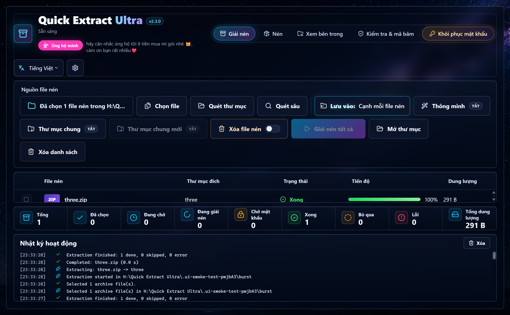

<div align="center">


# Quick Extract Ultra

**Phần mềm nén và giải nén miễn phí, dễ dùng cho Windows.**<br />
Mở, giải nén và tạo file ZIP, 7Z, RAR cùng hơn 30 định dạng khác, với giao diện gọn gàng, dễ chịu.

[English](../README.md) · [日本語](README.ja.md) · **Tiếng Việt** · [简体中文](README.zh-Hans.md)

[](https://github.com/nyankuro/quick-extract-ultra/releases/latest)

[](../LICENSE)
[](https://ko-fi.com/nyannyankuro)



</div>

## ✨ Có gì hay?

Quick Extract Ultra làm được những việc hằng ngày như WinRAR hay 7-Zip, và lúc nào cũng cho bạn thấy rõ mọi thứ đang diễn ra thế nào.

- 📦 **Giải nén cả đống file một lúc.** Mỗi file vào một thư mục riêng, có thanh tiến độ để bạn theo dõi.
- 🔑 **Gặp file có mật khẩu cũng không bị kẹt.** File đó chờ bạn nhập mật khẩu, các file khác vẫn chạy tiếp.
- 🧹 **Hết cảnh "thư mục lồng trong thư mục".** Chế độ thông minh bỏ bớt lớp thư mục thừa khi không cần.
- 🛡️ **An toàn cho dữ liệu.** Không ghi đè file nào, cũng không để lại kết quả giải nén dở dang.
- 🌏 **Có tiếng Việt**, cùng English, 日本語, 简体中文 và 繁體中文.
- 💻 **Chạy hoàn toàn trên máy bạn.** File của bạn không bao giờ bị gửi đi đâu.

## 📥 Tải về và cài đặt

1. Mở trang [**bản mới nhất**](https://github.com/nyankuro/quick-extract-ultra/releases/latest).
2. Chọn một trong hai:
   - **`QuickExtractUltra-Setup-x.y.z.exe`** là bản cài đặt, dễ nhất. Nó tạo lối tắt ở menu Start và ngoài màn hình, không cần quyền quản trị.
   - **`QuickExtractUltra-Portable-x.y.z-win-x64.zip`** là bản dùng ngay, không cần cài. Giải nén ra đâu cũng được (USB cũng được) rồi chạy `Quick Extract Ultra.exe`.
3. Mở app lên. Nếu Windows báo *"Windows đã bảo vệ PC của bạn"* (*Windows protected your PC*), bấm **Thông tin thêm** (*More info*) rồi **Vẫn chạy** (*Run anyway*). Thông báo này hiện ra vì app còn mới và chưa có chữ ký số. Toàn bộ mã nguồn đều công khai ở đây để ai cũng xem được.

Muốn gỡ app thì vào **Cài đặt của Windows → Ứng dụng**. Menu chuột phải cũng tự được gỡ theo.

### Giải nén thử trong 30 giây

1. Kéo các file nén vào cửa sổ app, hoặc bấm **Chọn file**.
2. Bấm **Giải nén tất cả**.
3. Xong! Mỗi file được giải nén vào một thư mục mới ngay bên cạnh nó.

## 📖 Hướng dẫn

### Giải nén

Mở thẻ **Giải nén**, rồi kéo file vào hoặc dùng các nút sau:

- **Chọn file**: tự chọn những file nén bạn muốn.
- **Quét thư mục**: tìm tất cả file nén trong một thư mục.
- **Quét sâu**: giống như trên, nhưng tìm cả trong các thư mục con.

Vài công tắc giúp bạn chỉnh theo ý mình:

- **Lưu vào**: nơi giải nén các file bạn đã chọn. Mặc định là *cạnh mỗi file nén*. Bấm vào để chọn thư mục khác, bấm × để quay về như cũ. (Khi quét thư mục, file luôn được giải nén cạnh file nén gốc.)
- **Thông minh**: nếu trong file nén chỉ có đúng một thư mục hoặc một file, app lấy thẳng ra mà không bọc thêm thư mục nào nữa.
- **Thư mục chung**: gom mọi kết quả vào một thư mục `Main Zip`. **Thư mục chung mới** tạo thêm một `Main Zip (1)` mới cho lần giải nén này.
- **Xóa file nén** (công tắc màu cam): **xóa vĩnh viễn** từng file nén ngay sau khi nó được giải nén thành công. File không vào Thùng rác, nên lần đầu bật app sẽ hỏi lại cho chắc. Nếu giải nén bị lỗi hoặc bị hủy thì không file nào bị xóa.

Bấm **Giải nén tất cả** là xong. Nếu tên thư mục đã có rồi, app tự thêm `(1)`, `(2)`... nên không bao giờ ghi đè lên gì cả.

Nếu một file cần mật khẩu, ô nhập mật khẩu sẽ hiện ngay trên dòng của file đó. Nhập vào rồi bấm **Tiếp tục**, hoặc bấm **Bỏ qua**. Trong lúc đó các file khác vẫn giải nén bình thường.

### Tạo file nén

1. Mở thẻ **Nén**, kéo file hoặc thư mục vào (hoặc bấm **Thêm file** / **Thêm thư mục**).
2. Đặt tên, chọn nơi lưu, định dạng và mức nén.
3. Nếu muốn, bạn có thể đặt mật khẩu (7Z hoặc ZIP), ẩn tên file (7Z), hoặc chia nhỏ thành nhiều phần (100 MB, 700 MB, 1 GB hoặc 4 GB).
4. Bấm **Tạo file nén**. Xong rồi thì bấm **Mở thư mục chứa** để xem.

> 💡 Mật khẩu file ZIP chỉ dùng được chữ cái không dấu, số và ký hiệu (giới hạn của 7-Zip). Nếu mật khẩu có tiếng Việt có dấu, hãy chọn định dạng 7Z.

### Xem bên trong file nén

Mở thẻ **Xem bên trong** rồi kéo file nén vào. Bấm đúp vào thư mục để đi vào, gõ tên để tìm, đánh dấu những thứ cần lấy rồi bấm **Giải nén mục đã chọn**. Không cần phải giải nén hết cả file.

### Kiểm tra và mã băm

Thẻ **Kiểm tra & mã băm** xem mọi file bên trong file nén có còn nguyên vẹn không, mà không cần giải nén. Nó cũng tính được CRC32, MD5, SHA-1, SHA-256 và SHA-512 cho bất kỳ file nào. Dán mã băm lấy từ trang web vào là so sánh được ngay.

### Menu chuột phải

Vào **Cài đặt → Menu chuột phải trong Explorer** và bật lên. Menu chuột phải sẽ có thêm *Giải nén... (chọn nơi lưu)*, *Giải nén tại đây (thông minh)*, *Giải nén vào thư mục*, *Thêm vào ZIP*, *Tính mã băm* và vài mục khác. Trên Windows 11, các mục này nằm trong **Hiển thị thêm tùy chọn** (*Show more options*), hoặc bấm Shift+F10. Menu chỉ được thêm cho tài khoản Windows của bạn, và sẽ biến mất khi bạn tắt cài đặt này.

### Lấy lại mật khẩu đã quên

Lỡ quên mật khẩu file ZIP hay RAR của chính mình? Thẻ **Khôi phục mật khẩu** có thể thử tìm lại giúp bạn.

> Bạn chỉ nên dùng tính năng này với file của mình, hoặc file mà bạn được phép mở.

- **Lần đầu tiên**, app cần ba công cụ miễn phí là bkcrack, hashcat và John the Ripper. Chúng không có sẵn trong app, nên bạn chọn **Tự động tải tất cả** (tải từ trang chính thức của từng công cụ) hoặc **Tôi tự thêm**. Chỉ cần làm một lần thôi.
- **Những lần sau**, chọn file nén rồi bấm **Thử tự động**. App sẽ thử các dãy số trước, rồi đến các mật khẩu phổ biến và biến thể của chúng, sau đó mới tìm rộng hơn. Với file ZIP kiểu mới và RAR5, app dùng card đồ họa (GPU); các loại còn lại thì dùng bộ xử lý (CPU).
- **Mức xử lý**: *Cân bằng* là lựa chọn tốt cho hầu hết mọi người. *Tiết kiệm* giúp máy mát và êm hơn, còn *Tối đa* nhanh nhất nhưng máy sẽ nóng hơn.
- Bạn có thể **Tạm dừng**, **Tiếp tục** hoặc **Hủy** bất cứ lúc nào. Khi tìm được mật khẩu, bạn có thể sao chép nó hoặc bấm **Giải nén ngay**.

Nên biết trước: mật khẩu ngắn, đơn giản có khi vài giây là ra, nhưng mật khẩu dài và ngẫu nhiên có thể mất cả mấy ngày, hoặc không tìm được. Nếu đó là file ZIP đời cũ và bạn vẫn còn giữ một file gốc nằm trong đó, app có thể dùng file ấy để mở khóa rất nhanh. Một số phần mềm diệt virus hay nhận nhầm các công cụ này là nguy hiểm, nên nếu công cụ vừa tải về đã biến mất, bạn thử xem trong mục cách ly của phần mềm diệt virus nhé.

### Cài đặt

| Cài đặt | Mặc định | Tác dụng |
|---|---|---|
| Ngôn ngữ | English | English, 日本語, Tiếng Việt, 简体中文 hoặc 繁體中文 |
| Menu chuột phải trong Explorer | Tắt | Thêm menu chuột phải như ở trên |
| Mở thư mục sau khi giải nén | Tắt | Tự mở thư mục kết quả khi giải nén xong |
| Giữ cảnh báo an toàn của file tải về | **Bật** | File giải nén từ file tải trên mạng vẫn mang dấu "tải từ internet", để SmartScreen và Office tiếp tục bảo vệ bạn |
| Chuyển file nén vào Thùng rác sau khi giải nén | Tắt | Nhẹ nhàng hơn công tắc *Xóa file nén*, vì bạn vẫn khôi phục lại được |
| Kiểm tra cập nhật | | Xem có phiên bản mới chưa, nếu có thì mở trang tải về |

## Câu hỏi thường gặp

**App có tạo được file RAR không?**
Không. Chỉ WinRAR mới tạo được file RAR. Quick Extract Ultra mở được file RAR (cả RAR5) và tạo được file 7Z, ZIP, TAR, là những định dạng phần mềm nào cũng mở được.

**App có gửi file của mình đi đâu không?**
Không. Mọi thứ chạy trên máy bạn bằng bộ máy 7-Zip quen thuộc, và app không theo dõi gì cả. App chỉ kết nối mạng khi chính bạn yêu cầu: lúc bấm **Kiểm tra cập nhật**, hoặc lúc tải các công cụ khôi phục mật khẩu.

**App mở được những định dạng nào?**
ZIP, ZIPX, 7Z, RAR (cả RAR5), TAR, GZ, TGZ, BZ2, XZ, TXZ, ZST, LZ, LZMA, Z, CAB, ISO, WIM, ARJ, LZH/LHA, CPIO, RPM, DEB, DMG, VHD, VHDX và XAR. File chia nhiều phần như `.part1.rar` hay `.7z.001` thì bạn chỉ cần mở phần đầu tiên.

**Sao lần đầu mở app Windows lại cảnh báo?**
App mới chưa có chứng chỉ chữ ký số (loại phải trả phí) thì Windows sẽ hiện cảnh báo SmartScreen. Bạn bấm **Thông tin thêm** (*More info*) rồi **Vẫn chạy** (*Run anyway*) là được. Mình rất muốn có chữ ký số cho app một ngày nào đó, và sự ủng hộ của bạn sẽ giúp điều đó thành hiện thực.

**Cài đặt của app được lưu ở đâu?**
Ở `%APPDATA%\quick-extract-ultra\settings.json`. Danh sách file nén và mật khẩu thì không bao giờ được lưu lại.

## ☕ Ủng hộ mình

Quick Extract Ultra miễn phí, và sẽ luôn miễn phí. Nếu app giúp bạn tiết kiệm được chút thời gian, một ly cà phê sẽ tiếp thêm động lực cho mình:

<a href="https://ko-fi.com/nyannyankuro"></a>

Trong app cũng có nút **Ủng hộ mình** ngay dưới tên ứng dụng. Bạn còn có thể giúp bằng cách:

- ⭐ **Bấm Star cho dự án.** Nhờ vậy nhiều người khác dễ tìm thấy nó hơn.
- 🐛 **Báo lỗi hoặc góp ý tính năng** ở mục [Issues](https://github.com/nyankuro/quick-extract-ultra/issues).

## Dành cho lập trình viên

<details>
<summary><b>Tự build từ mã nguồn</b></summary>

Bạn cần [Node.js](https://nodejs.org/) 22 trở lên và Windows 10/11.

```bash
git clone https://github.com/nyankuro/quick-extract-ultra.git
cd quick-extract-ultra
npm ci
npm run dev        # chạy thử, tự tải lại khi sửa code
npm test           # kiểm thử giải nén/nén với 7-Zip thật
npm run test:ui    # kiểm thử giao diện Electron
npm run dist       # tạo bản cài đặt và bản portable trong dist/
```

Cấu trúc: `electron/` (tiến trình chính, 7-Zip, menu Explorer), `src/` (giao diện React), `locales/` (bản dịch), `scripts/` (kiểm thử và công cụ).

Mọi báo lỗi, ý tưởng và bản dịch đều được chào đón ở [Issues](https://github.com/nyankuro/quick-extract-ultra/issues). Muốn thêm ngôn ngữ mới, hãy sao chép `locales/en.json`, dịch phần nội dung, rồi khai báo nó trong `src/i18n.tsx` và `electron/settings.cjs`.

</details>

## 📄 Giấy phép

© 2026 nyankuro. Quick Extract Ultra **miễn phí** và mã nguồn được công khai, theo [Giấy phép PolyForm Shield 1.0.0](../LICENSE) (bản tiếng Anh là bản có giá trị pháp lý). Nói đơn giản:

- ✅ Bạn được dùng miễn phí, ở nhà hay ở chỗ làm, chia sẻ cho người khác, và sửa lại để tự dùng.
- ❌ Bạn không được bán app, hoặc đưa nó (hay một bản đổi tên) ra làm sản phẩm cạnh tranh, kể cả khi phát miễn phí.

App dùng [7-Zip](https://www.7-zip.org/) của Igor Pavlov (GNU LGPL, kèm giới hạn unRAR). Các thành phần đi kèm khác vẫn giữ giấy phép riêng; xem [THIRD_PARTY_NOTICES.md](../THIRD_PARTY_NOTICES.md).
Cảm ơn những phần mềm nén tuyệt vời đã truyền cảm hứng: [7-Zip](https://www.7-zip.org/), [NanaZip](https://github.com/M2Team/NanaZip) và [PeaZip](https://github.com/peazip/PeaZip).

<div align="center">

Làm bằng cả tấm lòng ❤️ bởi nyankuro 🐈‍⬛

</div>
