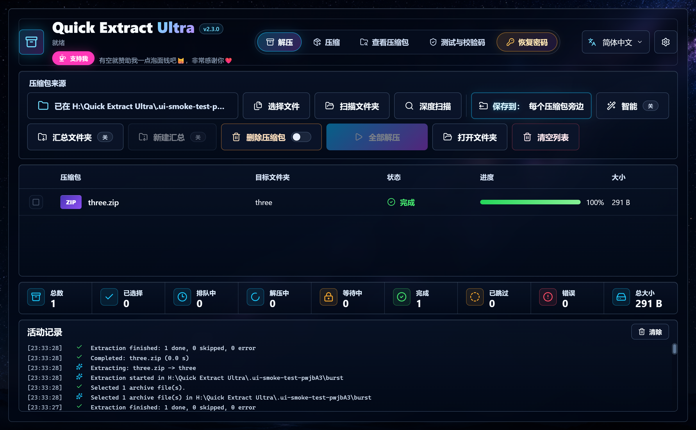

<div align="center">


# Quick Extract Ultra

**一款免费又好用的 Windows 压缩软件。**<br />
打开、解压和创建 ZIP、7Z、RAR 等 30 多种格式，界面清爽，用起来顺手。

[English](../README.md) · [日本語](README.ja.md) · [Tiếng Việt](README.vi.md) · **简体中文**

[](https://github.com/nyankuro/quick-extract-ultra/releases/latest)

[](../LICENSE)
[](https://ko-fi.com/nyannyankuro)



</div>

## ✨ 它好在哪

WinRAR、7-Zip 能做的日常工作它都能做，而且随时让你清楚地看到正在发生什么。

- 📦 **一次解压一大堆压缩包。** 每个压缩包都有自己的文件夹，进度一目了然。
- 🔑 **遇到密码也不卡住。** 需要密码的那个先等你输入，其他的照常继续。
- 🧹 **告别“文件夹里套同名文件夹”。** 智能模式会省掉多余的那层文件夹。
- 🛡️ **文件安全有保障。** 不会覆盖任何文件，也不会留下解压到一半的残局。
- 🌏 **支持简体中文**，还可以切换到繁體中文、English、日本語和 Tiếng Việt。
- 💻 **完全在你的电脑上运行。** 文件绝不会被上传到任何地方。

## 📥 下载与安装

1. 打开[**最新版本**](https://github.com/nyankuro/quick-extract-ultra/releases/latest)页面。
2. 二选一下载：
   - **`QuickExtractUltra-Setup-x.y.z.exe`**：安装版，最省事。会在开始菜单和桌面创建快捷方式，不需要管理员权限。
   - **`QuickExtractUltra-Portable-x.y.z-win-x64.zip`**：免安装的便携版。解压到任意位置（U 盘也可以），运行 `Quick Extract Ultra.exe` 即可。
3. 打开软件。如果 Windows 提示“Windows 已保护你的电脑”，请点击 **更多信息** →**仍要运行**。出现这个提示是因为软件比较新，还没有代码签名。全部源代码都公开在这里，谁都可以查看。

卸载时，在 Windows 的 **设置 → 应用** 里操作即可，右键菜单也会一并清除。

### 30 秒上手

1. 把压缩包拖进窗口，或者点击 **选择文件**。
2. 点击 **全部解压**。
3. 搞定！每个压缩包都会解压到它旁边的一个新文件夹里。

## 📖 使用指南

### 解压

打开 **解压** 页面，把压缩包拖进来，或者使用下面这些按钮：

- **选择文件**：自己挑选要解压的压缩包。
- **扫描文件夹**：找出某个文件夹里的所有压缩包。
- **深度扫描**：同上，并且连子文件夹也一起找。

还有几个开关，可以按你的习惯来调整：

- **保存到**：你选择的文件解压到哪里。默认是“每个压缩包旁边”。点击它可以换一个文件夹，点 × 就恢复默认。（扫描文件夹时，总是解压到压缩包旁边。）
- **智能**：如果压缩包里只有一个文件夹或一个文件，就直接取出来，不再额外套一层文件夹。
- **汇总文件夹**：把所有结果都放进同一个 `Main Zip` 文件夹。**新建汇总** 会为这一次新建一个 `Main Zip (1)`。
- **删除压缩包**（橙色开关）：每个压缩包解压成功后，立即将其**永久删除**。它不会进入回收站，所以第一次打开这个开关时，软件会先请你确认。解压失败或被取消时，什么都不会删除。

最后点击 **全部解压** 就行了。如果文件夹名已经存在，软件会自动加上 `(1)`、`(2)`……，绝不会覆盖任何东西。

如果某个压缩包需要密码，它那一行会出现密码框。输入后点击 **继续**，或者点击 **跳过**。这期间其他压缩包会照常解压。

### 创建压缩包

1. 打开 **压缩** 页面，把文件或文件夹拖进来（也可以用 **添加文件** / **添加文件夹**）。
2. 设置名称、保存位置、格式和压缩级别。
3. 需要的话，还可以设置密码（7Z 或 ZIP）、隐藏文件名（7Z），或者分卷（100 MB、700 MB、1 GB 或 4 GB）。
4. 点击 **创建压缩包**，完成后点 **在文件夹中显示** 就能找到它。

> 💡 ZIP 密码只能使用英文字母、数字和符号（这是 7-Zip 的限制）。如果密码里有中文，请选择 7Z 格式。

### 查看压缩包内容

打开 **查看压缩包** 页面，把压缩包拖进来。双击文件夹可以进入，也能按名称搜索。勾选需要的内容后点击 **解压所选**，不用把整个压缩包都解开。

### 测试与校验码

**测试与校验码** 页面可以在不解压的情况下，检查压缩包里的每个文件是否完好。它还能为任意文件计算 CRC32、MD5、SHA-1、SHA-256 和 SHA-512。把网站上给出的校验码粘贴进来，马上就能比对。

### 右键菜单

打开 **设置 → 资源管理器右键菜单**，资源管理器的右键菜单里就会多出“解压文件…（选择文件夹）”“在此解压（智能）”“解压到文件夹”“添加到 ZIP”“计算校验码”等选项。在 Windows 11 中，它们位于 **显示更多选项** 里（也可以按 Shift+F10）。菜单只会添加到你自己的 Windows 账户，关闭这个设置后就会消失。

### 找回忘记的密码

忘了自己 ZIP 或 RAR 文件的密码？**恢复密码** 页面可以帮你试着找回来。

> 请只用于你自己的文件，或你有权打开的文件。

- **第一次使用时**，需要三个免费的小工具：bkcrack、hashcat 和 John the Ripper。软件本身不带它们，你可以选择 **自动下载全部**（从各自的官方网站下载），或者 **我自己添加**。只需要设置一次。
- **之后**，选好压缩包，点击 **自动尝试** 就行。软件会先试数字，再试常见密码及其变体，然后扩大范围继续找。对于新式 ZIP 和 RAR5，它会用显卡（GPU）；其他情况则用处理器（CPU）。
- **处理强度**：一般选 *均衡* 就好。*节能* 让电脑更凉快、更安静，*最高* 速度最快，但电脑会更热。
- 随时都可以 **暂停**、**继续** 或 **取消**。找到密码后，可以复制它，或者直接点击 **立即解压**。

提前了解一下：简短的密码可能几秒钟就能找到，但又长又随机的密码可能要花好几天，甚至找不到。如果是旧式 ZIP，而你手上还留着压缩包里的某个原始文件，软件可以用它非常快地解开。另外，有些杀毒软件会把这类工具误报为危险程序。如果刚下载的工具不见了，请到杀毒软件的隔离区看看。

### 设置

| 设置 | 默认 | 作用 |
|---|---|---|
| 语言 | English | English、日本語、Tiếng Việt、简体中文、繁體中文 |
| 资源管理器右键菜单 | 关 | 添加上面介绍的右键菜单 |
| 解压后打开文件夹 | 关 | 完成后在资源管理器中打开结果文件夹 |
| 保留下载安全警告 | **开** | 从下载的压缩包里解压出的文件，会保留“来自互联网”的标记，让 SmartScreen 和 Office 继续保护你 |
| 解压后把压缩包移入回收站 | 关 | 比 *删除压缩包* 更温和，之后还能从回收站恢复 |
| 检查更新 | | 看看有没有新版本，有的话就打开下载页面 |

## 常见问题

**能创建 RAR 文件吗？**
不能。只有 WinRAR 才能创建 RAR 文件。Quick Extract Ultra 可以打开 RAR（包括 RAR5），并能创建任何软件都能打开的 7Z、ZIP 和 TAR 文件。

**会把我的文件发送到别处吗？**
不会。一切都在你的电脑上、用大家熟悉的 7-Zip 引擎完成，也没有任何跟踪统计。只有在你主动操作时软件才会联网：点击 **检查更新** 时，以及下载密码恢复工具时。

**能打开哪些格式？**
ZIP、ZIPX、7Z、RAR（含 RAR5）、TAR、GZ、TGZ、BZ2、XZ、TXZ、ZST、LZ、LZMA、Z、CAB、ISO、WIM、ARJ、LZH/LHA、CPIO、RPM、DEB、DMG、VHD、VHDX 和 XAR。像 `.part1.rar`、`.7z.001` 这样的分卷压缩包，打开第一个分卷即可。

**为什么第一次打开时 Windows 会警告？**
没有付费代码签名证书的新软件都会触发 SmartScreen 警告。点击 **更多信息** →**仍要运行** 即可。我很希望有一天能给软件签名，你的支持会让这一天早点到来。

**设置保存在哪里？**
保存在 `%APPDATA%\quick-extract-ultra\settings.json`。压缩包列表和密码永远不会被保存。

## ☕ 支持我

Quick Extract Ultra 是免费的，而且会一直免费。如果它帮你省了点时间，请我喝杯咖啡就是对我最大的鼓励：

<a href="https://ko-fi.com/nyannyankuro"></a>

软件标题下方也有一个 **支持我** 按钮。你还可以这样帮忙：

- ⭐ **给项目点个 Star。** 这样能让更多人找到它。
- 🐛 **反馈问题或提出建议**，欢迎来 [Issues](https://github.com/nyankuro/quick-extract-ultra/issues)。

## 给开发者

<details>
<summary><b>从源代码构建</b></summary>

需要 [Node.js](https://nodejs.org/) 22 或更高版本，以及 Windows 10/11。

```bash
git clone https://github.com/nyankuro/quick-extract-ultra.git
cd quick-extract-ultra
npm ci
npm run dev        # 开发模式运行（自动重新加载）
npm test           # 压缩包集成测试（使用真实的 7-Zip）
npm run test:ui    # Electron 界面测试
npm run dist       # 在 dist/ 中生成安装版和便携版
```

目录结构：`electron/`（主进程、7-Zip、资源管理器集成）、`src/`（React 界面）、`locales/`（翻译）、`scripts/`（测试与工具）。

欢迎在 [Issues](https://github.com/nyankuro/quick-extract-ultra/issues) 反馈问题、提出想法或贡献翻译。要添加新语言，请复制 `locales/en.json` 并翻译其中的内容，然后在 `src/i18n.tsx` 和 `electron/settings.cjs` 中注册。

</details>

## 📄 许可证

© 2026 nyankuro。Quick Extract Ultra **免费**，源代码按照 [PolyForm Shield License 1.0.0](../LICENSE) 公开（具有法律效力的是英文原文）。简单来说：

- ✅ 你可以免费使用（在家或在公司都行）、分享给别人，也可以修改后自己用。
- ❌ 你不能出售它，也不能把它（包括改名后的版本）作为竞争产品发布，即使免费发布也不行。

本软件使用了 Igor Pavlov 的 [7-Zip](https://www.7-zip.org/)（GNU LGPL，附 unRAR 限制）。其他附带组件各自遵循其许可证，详见 [THIRD_PARTY_NOTICES.md](../THIRD_PARTY_NOTICES.md)。
感谢带来灵感的优秀压缩软件：[7-Zip](https://www.7-zip.org/)、[NanaZip](https://github.com/M2Team/NanaZip) 和 [PeaZip](https://github.com/peazip/PeaZip)。

<div align="center">

由 nyankuro 用 ❤️ 制作 🐈‍⬛

</div>
